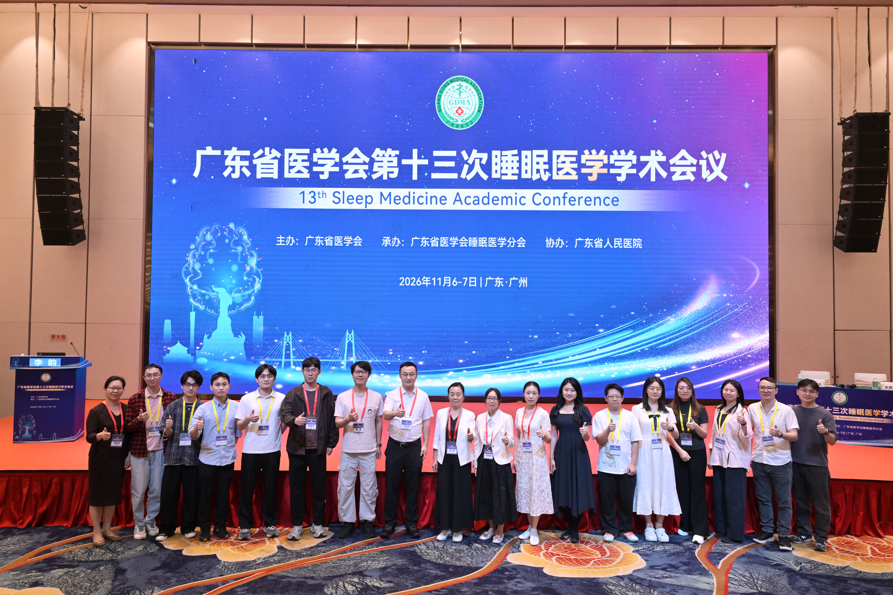
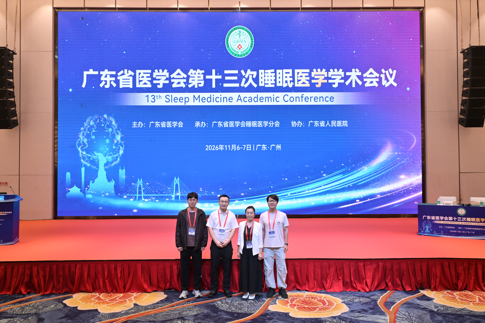
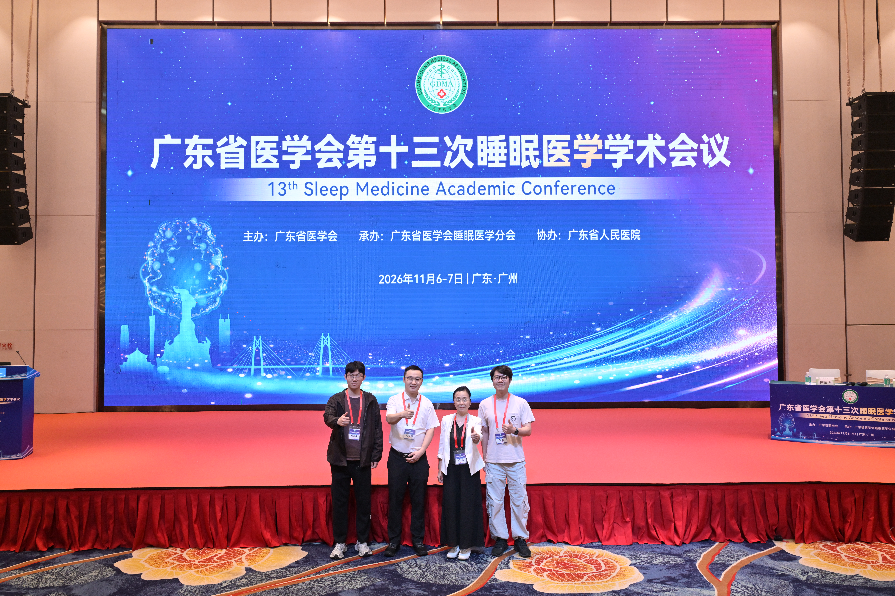
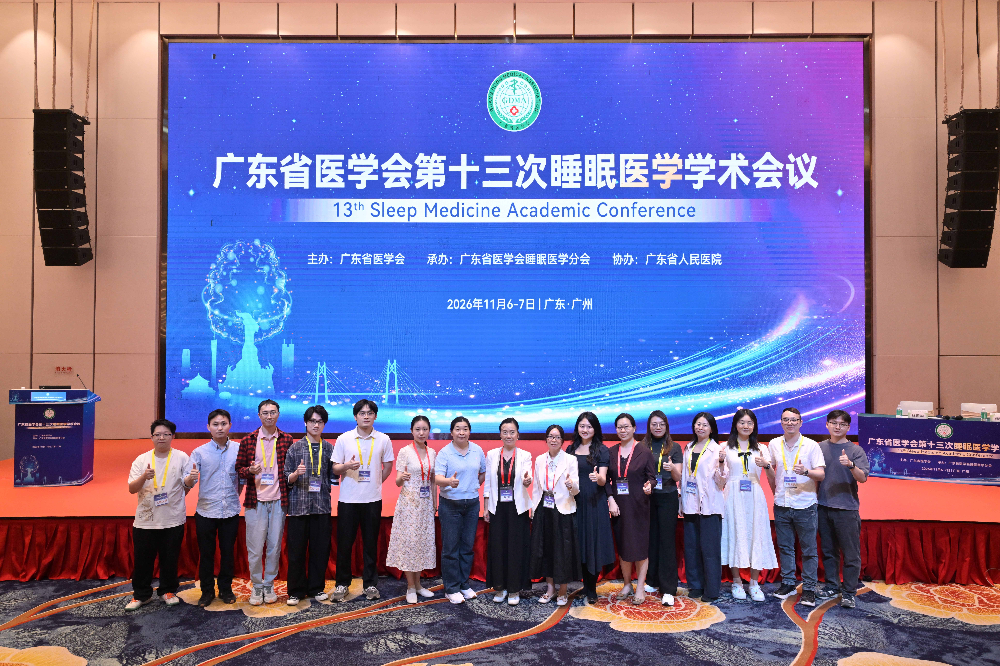

## 会议概况

11月6日至7日，广东省医学会第十三次睡眠医学学术会议在广州逸林假日酒店举行。本届年会以“数字赋能，规范诊疗，提升区域睡眠疾病防治能力”为主题，汇集睡眠医学及相关领域的临床与科研工作者，讨论睡眠障碍的诊疗进展与区域服务能力建设。

会议议题覆盖睡眠障碍与共病的整合管理、AI 与睡眠诊疗的临床转化、多学科协作模式，以及基层睡眠服务能力提升。贯穿这些讨论的共同问题是：如何让新的临床证据和数字工具进入实际工作流程，并惠及更多患者。

## 规范诊疗与共病管理

《成人阻塞性睡眠呼吸暂停诊治指南（2025）》为成人阻塞性睡眠呼吸暂停（OSA）的筛查、诊断、治疗和疾病管理提供了更新的循证建议，也讨论了特定患者群体的药物治疗选择。围绕指南更新，会议关注如何结合患者症状、共病情况和随访需求，制定更有针对性的诊疗方案。

睡眠问题常与其他慢性疾病相互交织。对于临床实践而言，识别共病、明确转诊与协作路径，并在治疗后持续评估患者状态，是实现规范管理的重要环节。

## AI 与数字医疗的临床转化

大会设置睡眠医学人工智能与数字医疗成果转化专场，讨论数字技术如何服务于病情评估、个体化建议和随访管理。工具的临床价值需要放在具体场景中检验：信息能否有效融入诊疗流程，医生能否据此作出判断，患者在院外能否获得连续支持。

从研究模型走向日常应用，还需要考虑数据质量、临床验证、工作流程衔接与使用者体验。将数字技术与临床需求结合，是推动睡眠诊疗从单次就诊走向持续管理的关键。

## 睡眠中心建设与区域协作

年会还设置睡眠中心建设与经验分享专场，讨论基层睡眠中心建设、中心医院学科发展和区域协作等实践问题。睡眠服务能力的提升，既需要专科资源和人才培养，也需要可执行的筛查、诊疗及转诊机制。

《国民健康“十五五”规划》鼓励二级及以上医疗机构设立睡眠等特色门诊。如何结合当地条件推进学科建设，让规范诊疗和数字工具更好地支持基层服务，是本次年会提出的现实课题。

